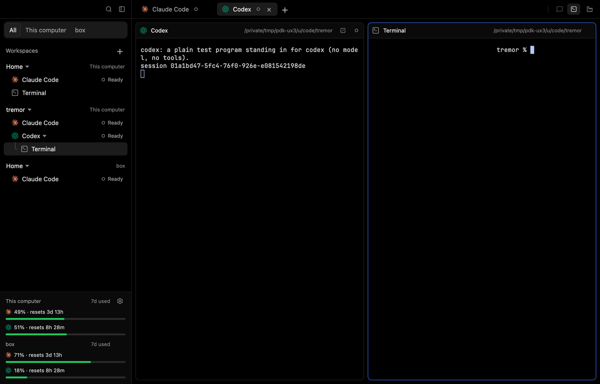
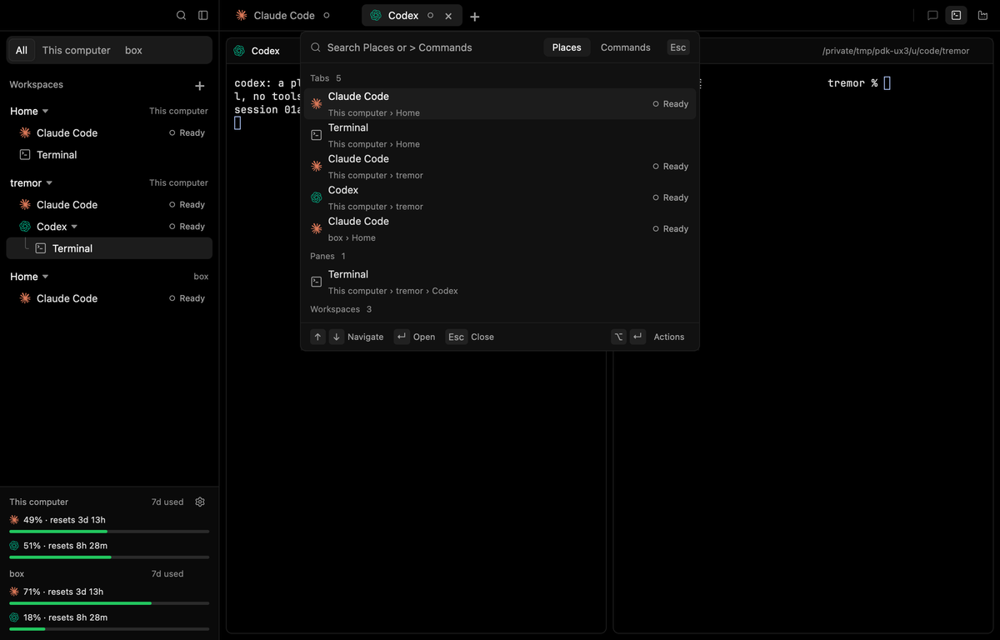
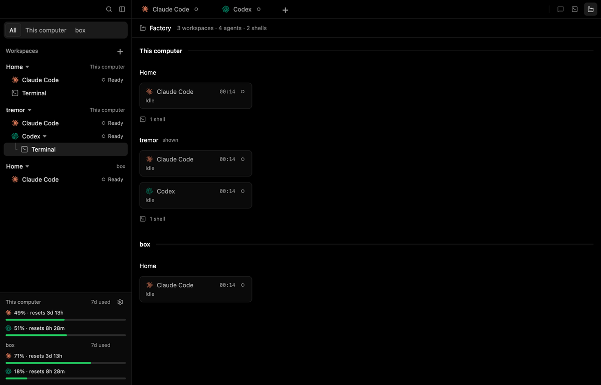

# tremor

Every agent on one screen.

tremor is a free, MIT layout and mod pack for the Herdr desktop app. It gives you a factory map of every agent on every machine, a readable chat view for Claude Code and Codex, and usage per machine, without editing Herdr's shipped files.

<p align="center">
  
</p>

- **Factory map.** Every running agent, grouped by machine and workspace, with its status, time and last report.
- **Readable chat.** Claude Code and Codex transcripts become clean messages. Flip any agent pane between Chat and Terminal.
- **Usage per machine.** See how much of each tool's limit is left on every machine, right in the sidebar.

```sh
git clone https://github.com/vib-z/tremor && cd tremor
modpack/install.sh --live ~/.config/herdr-app
```

macOS, built on Herdr app 0.1.15. Quit Herdr before installing. Workspaces, tabs, Settings and Add machine stay stock, and the uninstaller puts everything back.

If this saves you the tab hunt, star the repo so other people can find it.

## Contents

- [What it is](#what-it-is)
- [What it is not](#what-it-is-not)
- [Features](#features)
- [Requirements](#requirements)
- [Install](#install)
- [Usage](#usage)
- [How it works](#how-it-works)
- [Status and limits](#status-and-limits)
- [Repository layout](#repository-layout)
- [License](#license)

## What it is

tremor installs into the official [Herdr](https://herdr.dev) desktop app as one more layout, named `tremor`. It replaces the shipped sidebar, tab bar and pane header with a quieter set built from one small design system (tokens and components ported from shadcn/ui and T3 Code), and adds a structured chat, a factory map and per-machine usage. Workspaces, tabs, panes, menus, prompts, Settings and Add machine stay Herdr's own.

## What it is not

- **Not a fork.** It is a layout, themes and mods in Herdr's documented mod format. Herdr's shipped files and your other layouts are never edited.
- **Not a new terminal or agent runner.** Agents run in Herdr Core terminals as usual. tremor reads their state and transcripts and draws them.
- **Not an approval surface.** The chat shows what a blocked agent is asking, but you answer in the terminal. See [limits](#status-and-limits).
- **Not cross-platform yet.** Tested on macOS only.
- **Not a settings panel of its own.** Themes and options live in Herdr's Settings.

## Features

**Sidebar**
- A machine selector: All, This computer and each machine in one small menu that ends with Add machine. Picking one filters the tree, tab bar, palette, factory and usage.
- A thin tree: workspace, tab, pane, then Core sub-agents under their parent. One row per agent with its mark, name and status symbol (the word in its tooltip). Tab rows line up with their workspace's name.
- Git branch and ahead/behind per workspace, read from git on that workspace's machine.
- One **+** makes a workspace named after its folder, with your last-used agent already running in it.
- Double-click or F2 renames a workspace or tab in place. Right-click opens Herdr's own menu.

**Usage foot**
- Per machine: each installed agent's mark, percent used, reset time and a full-width bar.
- Read with each tool's own usage command, on the machine it belongs to. A dash when it can't be read, `stale` when a value is kept from a failed read.

**Tabs and panes**
- 28 px tabs: drag to reorder, double-click to rename, × on hover.
- **+** (⌘T) opens a new-tab menu with the agents installed on that machine and Terminal; 1 to 9 start them in order.
- An icon-only Grid / Factory toggle (Grid is the tab's panes as split).
- Pane header with agent mark, name, status and folder; split, expand and close buttons on hover. An expanded pane keeps them in view, with Restore lit.
- An agent's pane has an icon-only Chat / Terminal toggle in the middle of its bar, and the chat's header has the same one in the same place.

**Chat**
- Structured view of the focused agent's own transcript: turns, tool work, per-file diffs and the blocked request verbatim.
- Composer with Send and Stop, `/` commands (inserted, never sent), Folder… and Files… attachments, and a session-only model switch for Claude Code and Codex.
- Media tiles for images, video, PDFs and HTML files the agent names, with a preview dialog.
- A session is bound only by evidence (process id, open file, session id). Without it, the pane says so and falls back to the terminal.

**Palette and factory**
- ⌘K or ⌘P: one destination per running agent, then workspaces, tabs and panes; `>` for commands, ⌥↵ for actions.
- Factory: a full-width map of the agents actually running, grouped by machine and workspace, each with its status, time and last report.

**Themes**
- 24 themes on one token set, picked in Herdr's Settings: T3 light and dark, Moshi, and presets. Text meets WCAG AA on every surface (tested).
- Agents show their own marks in tremor and, through `programs.json`, in Herdr's own menus in every layout.

<table>
  <tr>
    <td></td>
    <td></td>
  </tr>
  <tr>
    <td align="center"><sub>Palette</sub></td>
    <td align="center"><sub>Factory</sub></td>
  </tr>
</table>

## Requirements

- macOS
- Herdr app 0.1.15 and herdr-core 0.1.20
- `/usr/bin/python3` (helpers), plus `ps`, `lsof`, `sips` and `qlmanage` (previews)
- [Bun](https://bun.sh) to run the tests

## Install

Quit Herdr first. The installer refuses a profile whose window is running.

```sh
modpack/install.sh --live ~/.config/herdr-app
```

Open Herdr, then pick **tremor** in the layout switcher, or:

```sh
herdr-app do layout.switch --name tremor
```

**Update:** pull, quit Herdr and run the same install command. It updates the pack and keeps the first backup.

**Remove:** quit Herdr and run:

```sh
modpack/uninstall.sh --live ~/.config/herdr-app
```

**Try it without touching your profile:** pass any other app home and omit `--live`, then open it with `HERDR_APP_HOME=<home>`. Without `--live`, both scripts refuse the live profile.

**Safety:** the first install keeps a copy of every file it replaces in `<home>/.pdk-backup/` and records each installed file's sha256. Uninstall restores that copy and refuses if you changed a pack file. Your other layouts, Herdr's shipped mods and your settings are never touched.

## Usage

| Key | Action |
|---|---|
| ⌘K, ⌘P | Palette (tremor layout only) |
| ⌘B | Show or hide the sidebar |
| ⌘T | New tab menu |
| ⌘⇧↵ | Expand the focused pane, or restore it |
| ⌘, | Herdr Settings |
| F2, double-click | Rename the selected workspace or tab |
| ↑ ↓ ← → , Enter | Move, fold and open in the tree |
| ⌥↵ | Actions for the chosen palette result |

Every action is also a command, so it can be bound in `keys.json` or run as `herdr-app do <mod>.<command>`, for example `pdk-tree.new-workspace` or `pdk-tree.machine:all`. The full list is in [modpack/README.md](modpack/README.md).

## How it works

- `modpack/layouts/tremor.json` is cloned from Herdr's shipped `main` layout and places the mods.
- Each mod in `modpack/mods/` draws one surface from live app state, using `modpack/shared/ui.js` for every token and component.
- Pure logic (tree model, transcript readers, status, themes, factory board) lives in `modpack/adapters/` and is unit tested.
- Two Python helpers in `modpack/helper/` run a fixed set of read commands: one for chat, previews and the tree, one for usage. The only network fetch is an image you click to preview.
- What each mod reads and runs is listed in [modpack/README.md](modpack/README.md#what-each-mod-reads-and-runs-r11).

## Status and limits

Private and in daily use. Built and reviewed against Herdr 0.1.15 and herdr-core 0.1.20.

Chat support:

| Agent | Chat |
|---|---|
| Claude Code, Codex, Hermes | Verified on real sessions |
| Grok Build, Pi, OpenCode | Partial: format from source or docs |
| Kimi Code, Gemini CLI, Cursor Agent | Terminal only |

Known limits, mostly from Herdr and Core today:

- Approval and question cards are display only. Core has no guarded keypress, so answering from the chat could hit the wrong prompt.
- Relays between agents are not drawn, because Core does not record who sent a message.
- Claude usage on a Mac reached over ssh can show a dash: the sign-in is in the login keychain, which ssh can't open.
- Real pointer and keyboard input has been tested only in part; most checks drive the app through its own commands.
- Theme names in Herdr's Settings still start with `pdk`, the pack's internal prefix.


## Repository layout

```
modpack/        the pack: layout, mods, themes, helpers, installer, tests
docs/modpack/   plan and QA notes for the pack
docs/images/    README images
packages/, docs/spec.md, docs/design/   an earlier standalone client design, shelved
```

Run the tests with `bun test modpack/test`.

## License

MIT, see [LICENSE](LICENSE). Third-party code and icons keep their own licenses; see [modpack/NOTICE.md](modpack/NOTICE.md) and [modpack/licenses/](modpack/licenses).
