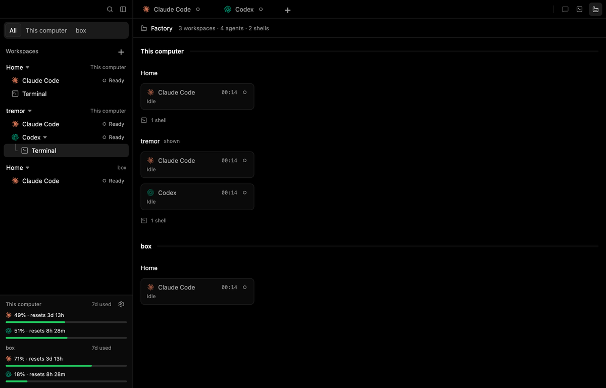

# tremor

A quieter window for running many coding agents. A thin sidebar lists every workspace, tab and agent on every machine, a factory map shows all running agents at once, agent panes flip between a readable chat and the terminal, and the sidebar foot shows usage per machine.

## What you see

- **Sidebar, 280px (240 to 480), chrome background.** A 40px head with search and collapse, a machine selector (All, This computer, each machine, Add machine), then a tree: workspace, tab, pane, with Core sub-agents under their parent. One row per agent: its mark, name and a status symbol. A 40px usage foot at the bottom: per machine, each tool's percent used and when it resets.
- **Tab bar.** One tab per agent or shell with its mark and status, a + for a new tab, and icon-only toggles on the right: Chat / Terminal and Grid / Factory.
- **Work area.** Panes as Herdr splits them, each with a slim header (name, folder, controls). In Factory mode the work area becomes a full-width map grouped by machine, then workspace, with one card per agent (mark, name, time in state, last report) and a shell count. A Map / Board toggle puts the Map first: leads first, and a click on a lead opens its team in place (Esc or a second click closes it).
- **Look.** T3 / shadcn style tokens, Geist UI font at 13px, light and dark themes (pdk-t3-light, pdk-t3-dark), Lucide icons, grey by default with colour only for blocked, error and unseen done.

## How it behaves

- **Status.** Working, blocked, done and idle each have their own symbol; the word is in the tooltip. Blocked and error get colour; done stays marked until seen.
- **Chat.** Claude Code, Codex and Hermes transcripts render as messages, tool calls and diffs. Grok Build, Pi and OpenCode are partial; Kimi Code, Gemini CLI and Cursor Agent stay terminal only. You still answer approvals in the terminal.
- **Keys.** Cmd+K opens a palette with one destination per running agent. Clicking a factory card opens that agent's tab.
- **Machine selector** filters the tree, tab bar, palette, factory and usage.

## Built from

- `layouts/tremor.json`: a row with the sidebar column (blocks `pdk-tree` head, `pdk-tree`, `pdk-usage`) and the work column (`pdk-tabs`, panes with `pdk-pane`, `pdk-factory`, `pdk-chat`).
- Mods in `mods/`: pdk-tree, pdk-tabs, pdk-pane, pdk-chat, pdk-factory, pdk-usage, pdk-search, pdk-new-menu, pdk-settings, pdk-machine-add and helpers. Tabs, pane and new-menu are modified clones of Herdr's shipped mods (Apache-2.0, see NOTICE.md).
- Programs: a bounded Python helper (`helper/pdk-helper.py`, `helper/pdk-usage.py`) reads transcripts by byte range and each tool's usage. It runs on the machine the agent is on.

## Watch out

- **Add it with the installer, not by copying folders.** From a clone of the repo, with Herdr quit, run `modpack/install.sh --live ~/.config/herdr-app`. Copying only `layouts/` and `mods/` leaves out each mod's `lib/` (built from `adapters/` and `shared/`), the helpers, themes and icons, and the layout will not run. The installer backs up what it replaces and `modpack/uninstall.sh --live ~/.config/herdr-app` restores it.
- macOS only, built on Herdr app 0.1.15 and herdr-core 0.1.20.
- Mods see live state only, so time in state is counted from when the app started.
- The chat cannot approve a blocked agent.

## Done when

- `tremor` appears in the layout switcher and `layout.switch --name tremor` opens it.
- The sidebar tree lists every running agent with a status symbol, and the usage foot shows a row per machine.
- Factory mode shows one card per running agent, grouped by machine.
- A Claude Code or Codex pane flips to Chat and shows the last prompt and answer.
